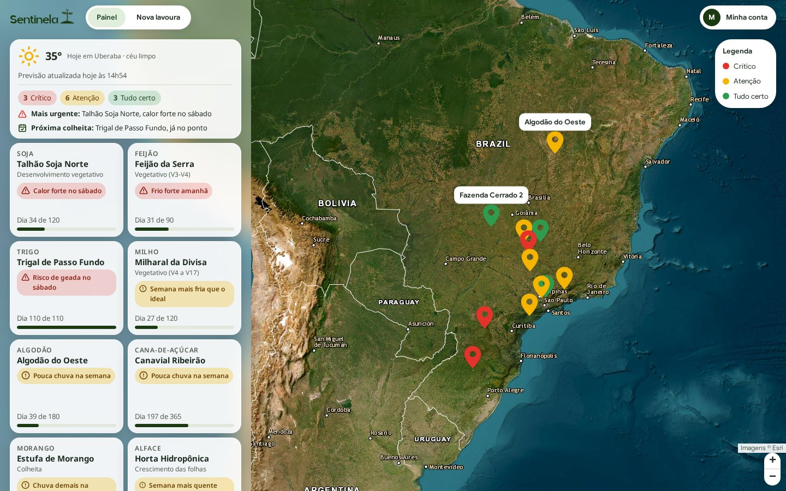
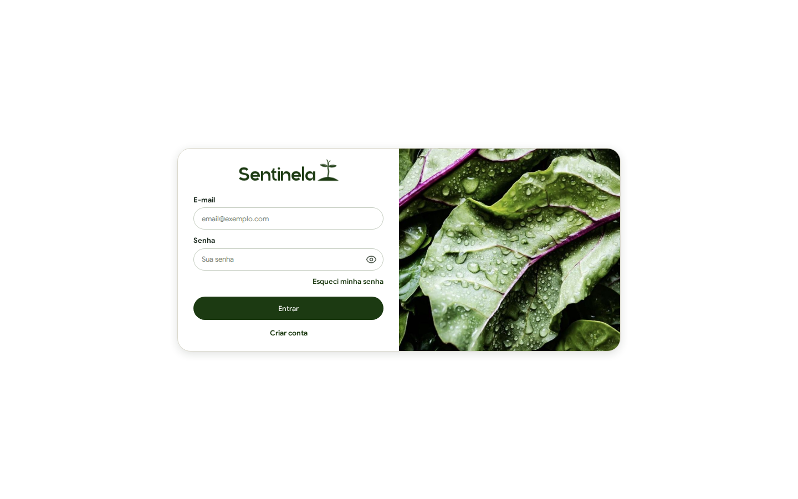
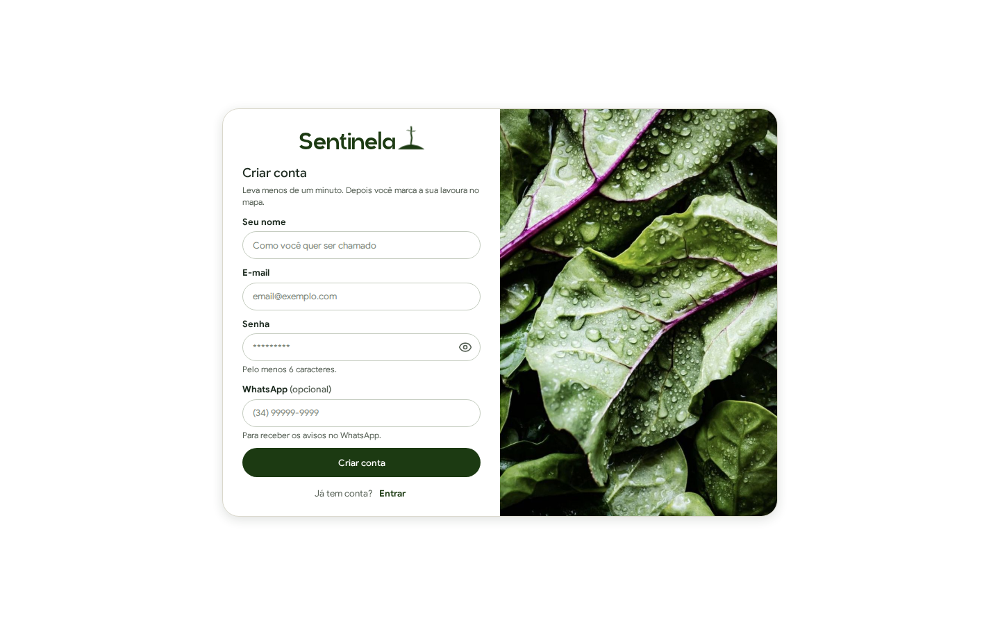
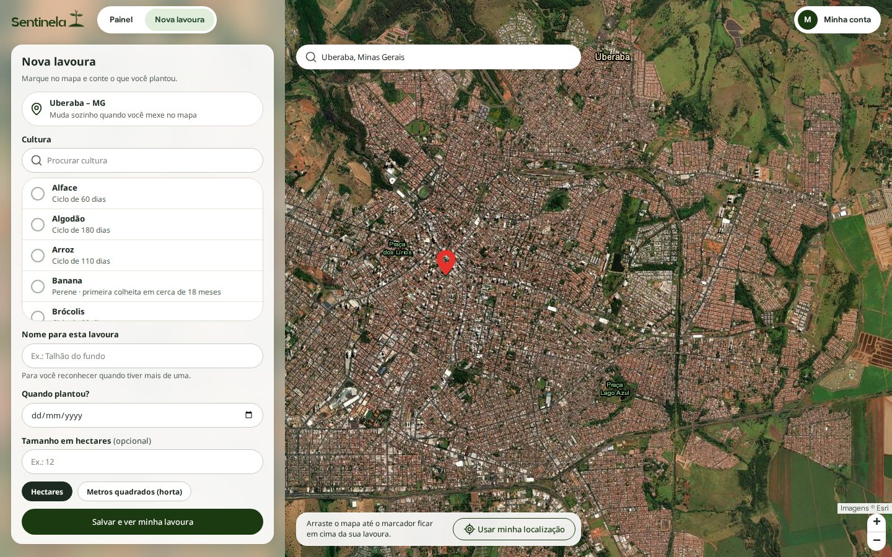
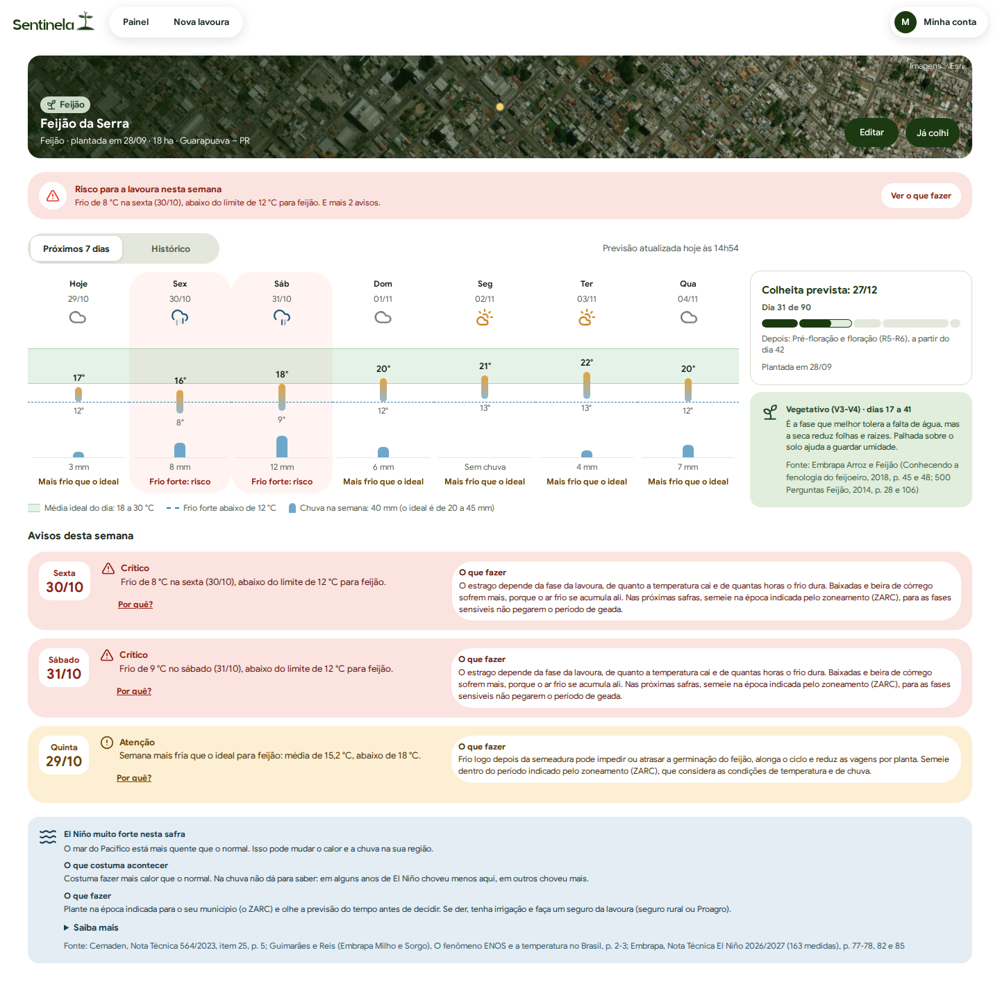
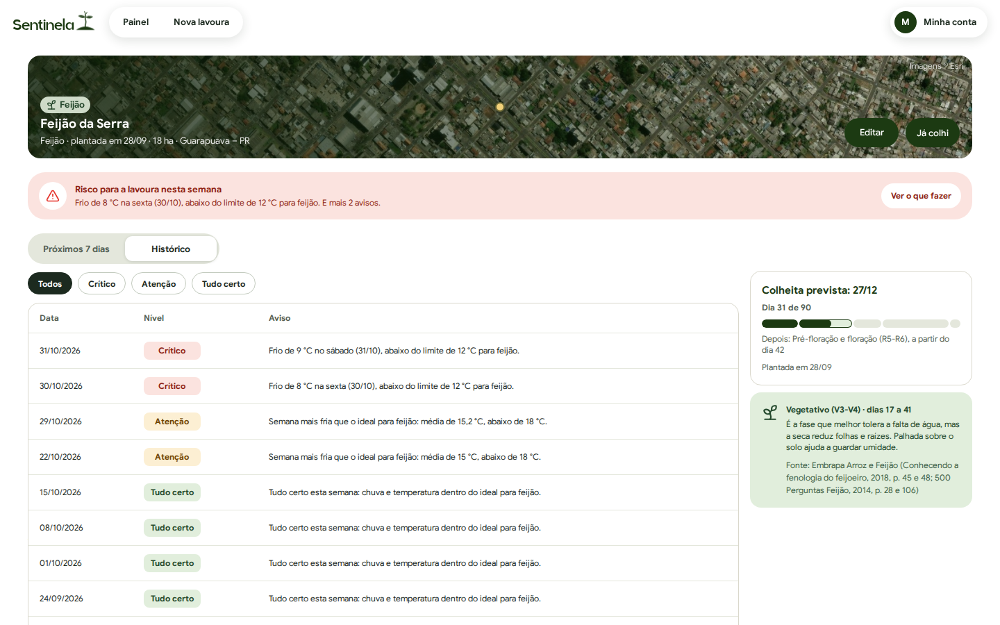
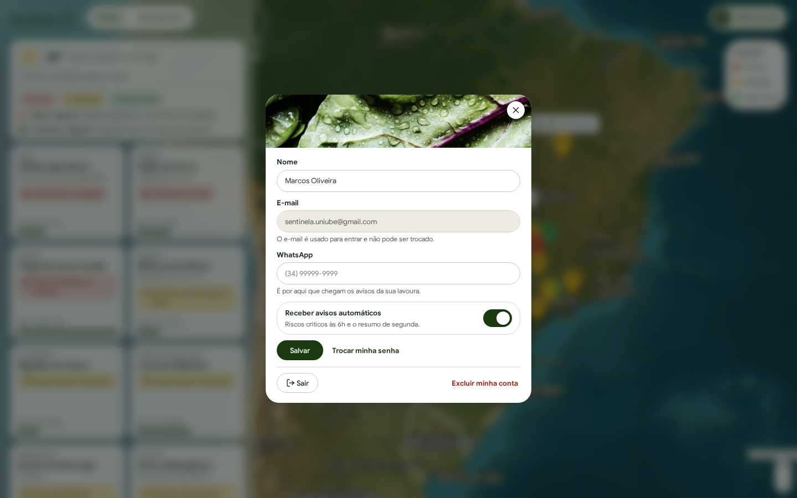
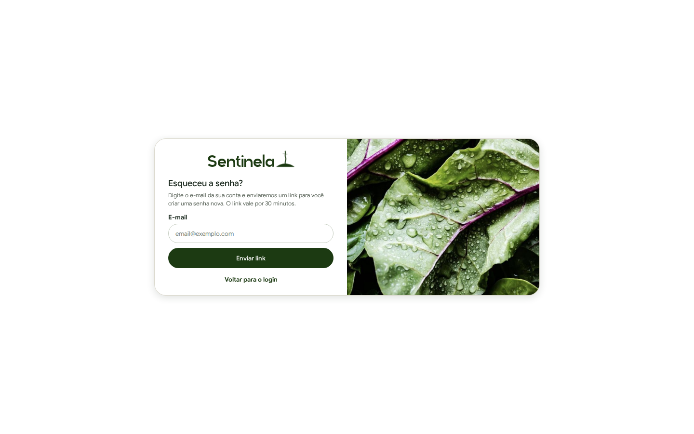
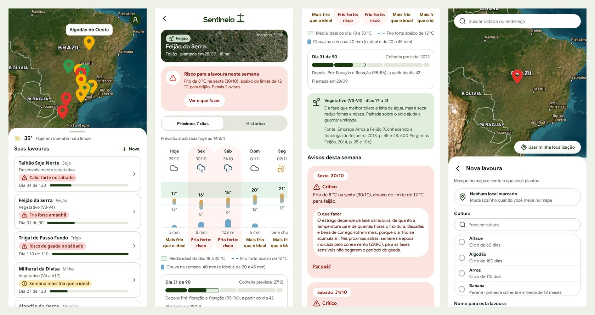

<p align="center">
  
</p>

# Sentinela

**Traduz a previsão do tempo para o que ela significa em cada lavoura: o que vai acontecer, por quê, e o que fazer.**

Trabalho da disciplina **Projetos Integrados 2 (VIA231)**, Uniube, 2026/2.
Equipe: **Jessica Rodrigues** e **Larissa Miuki**.

**Site no ar:** https://sentinela-sepia.vercel.app



---

## O problema

A previsão do tempo é gratuita e está em qualquer celular, mas vem em graus e milímetros. Saber se 36 °C é um problema para a soja, ou se 94 mm de chuva na semana é demais para o feijão, exige conhecimento agronômico que o pequeno e o médio produtor nem sempre tem, porque não conta com consultoria no dia a dia. A informação existe, mas não chega em formato que dê para agir.

O Sentinela compara a previsão de 7 dias do **ponto exato da lavoura** com o que a cultura plantada aguenta, e avisa em linguagem direta, com a fonte técnica de cada número.

## O que o produtor faz

1. **Cria a conta** com nome, e-mail, senha e o WhatsApp.
2. **Marca a lavoura no mapa** (satélite), escolhe a cultura, a data de plantio e a área. A cidade é descoberta pelo ponto marcado.
3. **Acompanha o painel:** a frase da semana, o tempo de hoje e cada lavoura com a fase do ciclo e o aviso principal, por cor: 🔴 crítico, 🟡 atenção, 🟢 tudo certo.
4. **Abre a lavoura** para ver o resumo da semana, o gráfico de 7 dias, o que fazer e o histórico de avisos.
5. **Consulta pelo WhatsApp** e recebe os avisos críticos sem abrir o site.

| | |
|---|---|
|  |  |
| **Entrar** | **Criar conta** |



**Nova lavoura.** A busca de endereço leva o mapa até a cidade; o produtor arrasta o mapa até o marcador ficar em cima da lavoura, e o município aparece sozinho.



**Detalhe da lavoura.** De cima para baixo:
- a **foto de satélite do lugar**, com o ponto onde a lavoura foi marcada;
- o **resumo da semana**, com o aviso mais sério na cor do nível e o caminho até o que fazer;
- o **gráfico de 7 dias**: cada dia é uma barrinha da mínima à máxima, sobre a **faixa de temperatura ideal da cultura** (verde) e o limite de calor ou de frio (tracejado). A chuva vem em barras, e a legenda mostra a chuva da semana contra o ideal. Só os dias fora do normal levam frase;
- o **ciclo dividido nas fases da cultura**, com a fase de hoje e o que ela pede;
- os **avisos da semana**, cada um com **O que fazer** (manejo com fonte) e **Por quê?** (o limite da cultura que foi passado). Passar o mouse num aviso acende o dia dele no gráfico;
- o contexto do **El Niño / La Niña** da safra.

| | |
|---|---|
|  |  |
| **Histórico**, com filtro por nível e 20 avisos por página | **Minha conta**: a chave de avisos automáticos salva na hora |



**Esqueci minha senha.** Envia por e-mail um link de uso único, válido por 30 minutos. A tela responde igual tenha conta ou não, para não revelar quem está cadastrado.

### No celular

O site é responsivo: o painel vira um mapa com a lista de lavouras numa folha que sobe, e o detalhe ocupa a tela inteira.



---

## O bot do WhatsApp

Um canal de **consulta**: o produtor pergunta e o sistema responde com os dados dele. O cadastro e a edição ficam só no site.

- **Reconhece a pessoa pelo número** salvo na conta, com ou sem o 9º dígito. Quando o WhatsApp esconde o número e manda só um identificador (`@lid`), o bot o guarda na conta para reconhecer a pessoa nas próximas mensagens. Quem não tem conta não vê dado de ninguém.
- **Menu numerado:** a pessoa responde `1`, `2` ou `3`, ou escreve `menu`.
- **Manda sozinho:** boas-vindas ao cadastrar o número, aviso crítico (com o "O que fazer") e o resumo da semana, às segundas.
- **Respeita a chave** "Receber avisos automáticos" de Minha conta.
- A **Evolution API** (um WhatsApp Web automatizado, conectado por QR Code) roda no Docker e recebe e envia as mensagens. O backend recebe cada mensagem por webhook.

Como as respostas chegam:

```
👋 Olá, Marcos!
Sou o assistente do Sentinela.

O que você quer ver? Responda com o número:

1 - Minhas lavouras
2 - Avisos da semana
3 - Previsão do tempo
```

```
🚨 Avisos da semana

🔴 Crítico · Feijão da Serra
Frio de 8 °C na sexta (30/10), abaixo do limite de 12 °C para feijão.

🟡 Atenção · Milharal da Divisa
Chuva demais: 92,4 mm previstos na semana. O máximo para milho é 47,1 mm.
```

```
🌤️ Previsão para Uberaba
Canteiro de morango

Qui 29/10  20° a 27°  🌧️ 33,4 mm
Sex 30/10  20° a 26°  🌧️ 19,2 mm
Sáb 31/10  19° a 28°  🌧️ 6,2 mm
...
💧 Chuva na semana: 73 mm
```

O bot reconhece palavras-chave e números do menu; não usa modelo de linguagem. Os textos ficam em `WhatsAppService.java`, e o formato em `FormatoDoBot.java` e `MenuDoBot.java`.

---

## Como é feito

```
 site (React)  ──►  API (Spring Boot)  ──►  banco (MySQL)
 Vercel              Render                  Aiven
                       │  ▲
        Open-Meteo ◄───┤  └── webhook ── Evolution API ── WhatsApp
        NOAA (ENSO) ◄──┘                   (Docker + ngrok)
```

| Peça | Tecnologia | Onde |
|---|---|---|
| Site | React 19, Vite, TypeScript, styled-components, TanStack Query, Leaflet | Vercel |
| API | Java 21, Spring Boot 3.5, Spring Data JPA, JWT | Render |
| Banco | MySQL 8 | Aiven |
| Previsão | Open-Meteo (grátis, sem chave) | |
| El Niño / La Niña | índice ONI da NOAA, atualizado todo dia 6 | |
| Mapas | Leaflet, imagens de satélite da Esri, busca Photon e OpenStreetMap | sem chave |
| Bot | Evolution API, no Docker, exposta pelo ngrok | notebook da equipe |

**Qualidade:** o site tem 190 testes automatizados e o backend, 32, entre eles as regras de aviso, o ciclo das culturas e os textos do bot. Senhas são guardadas com BCrypt, o login usa JWT, e cada pessoa só enxerga as próprias lavouras.

---

## Como rodar tudo

Pré-requisitos: Docker, Java 21 e Node 22.22 ou mais novo.

### 1. Banco

```bash
docker compose up -d
```

Sobe um MySQL 8.0 na porta **3307**, com o banco `sentinela` já criado (usuário `root`, senha `root_local`). Depois, rode os scripts na ordem:

```bash
M="docker exec -i sentinela-mysql mysql -uroot -proot_local --default-character-set=utf8mb4 sentinela"
$M < database/schema/01_ddl.sql            # as 12 tabelas
$M < database/schema/02_whatsapp_lid.sql   # coluna que o bot usa para reconhecer quem o WhatsApp esconde
$M < database/seeds/02_dados_iniciais.sql  # municípios, 19 culturas, série do El Niño, administrador
$M < database/seeds/03_orientacoes.sql     # "O que fazer" de cada aviso e as fases do ciclo
$M < database/seeds/04_demonstracao.sql    # conta de demonstração com 4 lavouras
```

Para recriar do zero, apague o banco antes: `docker exec sentinela-mysql mysql -uroot -proot_local -e "DROP DATABASE sentinela; CREATE DATABASE sentinela CHARACTER SET utf8mb4;"`.

### 2. API

```bash
cd src/backend
./mvnw spring-boot:run -Dspring-boot.run.profiles=dev
```

Sobe em `http://localhost:8080`. O perfil `dev` libera `POST /api/interno/rodar-rotina`, que roda na hora a rotina das 6h (previsão nova, avisos refeitos e WhatsApp), e `POST /api/interno/atualizar-enso`, que busca na NOAA a série do El Niño (a rotina automática roda todo dia 6). A documentação interativa fica em `http://localhost:8080/swagger-ui.html`.

Tudo o que muda em produção vem de variáveis de ambiente, com valores de desenvolvimento como padrão (ver `.env.example`): `DB_URL`, `DB_USER`, `DB_PASSWORD`, `JWT_SECRET`, `FRONT_ORIGENS`, `FRONT_URL` e `MAIL_HOST`/`MAIL_USER`/`MAIL_PASSWORD`. Sem `MAIL_HOST`, o link de "Esqueci minha senha" aparece no log da API em vez de ir por e-mail.

### 3. Front

```bash
cd src/frontend
npm install
npm run dev:api   # o site falando com a API de verdade (a da porta 8080)
npm run dev       # o site com a API de mentira, sem precisar do backend
```

Abre em `http://localhost:5173`. Os mapas são do Leaflet, com imagens da Esri e endereços do OpenStreetMap: não pedem chave nem conta. Detalhes em [`src/frontend/README.md`](src/frontend/README.md).

### Deploy

Site na Vercel, API no Render e banco na Aiven: passo a passo e variáveis em [`docs/deploy.md`](docs/deploy.md).

### Contas

| Conta | Senha | Para quê |
|---|---|---|
| `joao@exemplo.com` | `123456` | Produtor da demonstração, com 4 lavouras perto de Uberaba |
| `admin@sentinela.com` | `admin123` | Único que cadastra e altera culturas pela API (Postman) |
| `sentinela.uniube@gmail.com` | com a equipe | Conta de demonstração do site publicado, com 12 lavouras e avisos de todos os níveis (`database/seeds/05_conta_demonstracao.sql`) |

---

## Roteiro da demonstração

1. Entre na conta de demonstração (`sentinela.uniube@gmail.com`): o painel mostra 12 lavouras, com avisos críticos, de atenção e "tudo certo".
2. Abra o **Feijão da Serra**: geada crítica na sexta e no sábado. Mostre o resumo, o gráfico com o limite de frio, o **O que fazer** e o **Por quê?** (a faixa da cultura e a fonte).
3. Abra o **Talhão Soja Norte**: calor forte por 5 dias seguidos, em vermelho no gráfico.
4. Mostre o **Histórico** de avisos e o filtro por nível.
5. Peça ao professor para **criar uma conta** com o WhatsApp dele e **cadastrar uma lavoura** no mapa: a previsão real do ponto já vem e os avisos aparecem.
6. Peça que ele mande **"oi"** para o número do bot e responda `1`, `2` ou `3`.
7. Em **Minha conta**, mostre a chave de avisos automáticos e o botão **Trocar minha senha**, que manda um link por e-mail.

Antes de apresentar, depois das 6h do dia, rode de novo `database/seeds/05_conta_demonstracao.sql` (comando em [`docs/deploy.md`](docs/deploy.md)): ele fixa a previsão e os avisos da conta de demonstração para o painel não depender do clima do dia.

## Rotas da API

Todas exigem `Authorization: Bearer <token>`, menos login, cadastro, esqueci a senha e nova senha. Erros sempre no formato `{ status, mensagem, campos }`. Contrato completo no doc "Sentinela — Especificação da API".

| Método | Rota | Tela |
|---|---|---|
| `POST` | `/api/auth/login` | Entrar |
| `POST` | `/api/auth/esqueci-senha` | Esqueci minha senha, Trocar senha |
| `POST` | `/api/auth/redefinir-senha` | Criar nova senha (410 com link vencido) |
| `POST` | `/api/usuario` | Cadastro (já devolve o token) |
| `GET` `PATCH` `DELETE` | `/api/usuario/me` | Minha conta, Excluir conta |
| `GET` | `/api/culturas` | Lista de "O que você plantou?" |
| `GET` | `/api/culturas/{id}` | Faixas e fonte de uma cultura |
| `POST` `PATCH` | `/api/culturas`, `/api/culturas/{id}` | Só o administrador (403 para os outros) |
| `GET` | `/api/painel` | Painel |
| `POST` | `/api/cultivos` | Nova lavoura (pelo ponto do mapa) |
| `GET` | `/api/cultivos/{id}` | Detalhe: ciclo, fase, El Niño, avisos com "O que fazer", previsão |
| `GET` | `/api/cultivos/{id}/alertas` | Histórico, com filtros e 20 por página |
| `PATCH` | `/api/cultivos/{id}` | Editar lavoura, Já colhi |
| `DELETE` | `/api/cultivos/{id}` | Excluir lavoura |
| `GET` | `/api/alertas`, `/api/enso/atual`, `/api/whatsapp/historico` | Consultas de apoio |

Referência completa das rotas, com exemplos: [`docs/especificacao_api.md`](docs/especificacao_api.md). Coleção do Postman com todas elas: [`docs/postman_sentinela.json`](docs/postman_sentinela.json) (a do CP-2 continua em `docs/postman_cp2.json`).

---

## Como o Sentinela decide o aviso

Uma rotina roda todo dia às 6h (e logo depois de salvar ou editar uma lavoura): busca na Open-Meteo os 7 dias do **ponto exato** da lavoura, guarda em `previsao_diaria` e compara com as faixas da cultura.

| Aviso | Quando | Nível |
|---|---|---|
| Geada ou frio forte | mínima de algum dia abaixo do limite crítico de frio | crítico |
| Calor forte | média das máximas dos 7 dias acima do limite crítico de calor (um dia quente sozinho fica em atenção) | crítico |
| Semana fria ou quente | média da semana fora da faixa ideal (não vale para perenes) | atenção |
| Chuva demais ou pouca chuva | chuva da semana fora da faixa da cultura | atenção |
| Tudo certo | nenhum dos casos acima | info |

Cada aviso vem com três partes: a **mensagem** (o que vai acontecer), o **Por quê?** (a faixa da cultura e a fonte) e o **O que fazer** (tabela `recomendacao`: primeiro o texto da cultura; sem ele, o genérico do tipo de aviso). A lavoura também mostra a **fase do ciclo** em que está (tabela `fase_cultura`) e o que essa fase pede. Todo texto e todo número têm fonte da Embrapa, do MAPA ou da EPAMIG, registrada na coluna `fonte`.

Os avisos críticos novos vão para o WhatsApp de quem não desligou a chave "Receber avisos automáticos" em Minha conta. Toda mensagem enviada ou recebida fica gravada na tabela `mensagem`.

---

## As culturas

| Tipo de ciclo | Culturas | Como funciona |
|---|---|---|
| `anual` | feijão, milho, soja, algodão, sorgo, trigo, arroz, alface, brócolis, repolho | colhe no fim do ciclo; "Dia X de Y" |
| `cana` | cana-de-açúcar | ano e meio se plantada de janeiro a março, senão 12 meses |
| `continua` | tomate, pepino, couve, morango, chuchu | a colheita começa no meio do ciclo e vai até o fim |
| `perene` | café, banana, goiaba | só os limites críticos geram aviso; o café tem safra (colheita de maio a agosto) |

São 19 culturas. As frutas e hortaliças entraram quando havia, em publicação técnica, todos os números que o sistema precisa: faixa ideal, limites de dano por frio e por calor, necessidade de água e duração do ciclo. A fonte preferida é sempre a Embrapa ou o MAPA; quando eles não dão o número, ele vem do IAC, da Epagri ou da FAO (Ecocrop), e a coluna `fonte` diz qual. Ficaram de fora a rúcula e a couve-flor, que não têm limite de dano por temperatura em número em nenhuma dessas fontes.

Geada: a mínima do ar abaixo de 3 °C (medida a 2 m, como na previsão) indica temperatura negativa na planta, o critério usado pela Embrapa Clima Temperado (Doc. 283), pela Embrapa Trigo e pela Epagri.

---

## As 12 tabelas

| Tabela | O que guarda |
|---|---|
| `usuario` | Produtor cadastrado no site, com o WhatsApp (E.164), a chave `avisos_whatsapp` (PARAR/VOLTAR) e o `papel` (`produtor` ou `admin`). |
| `redefinicao_senha` | Links de nova senha: só o hash SHA-256 do código, a validade (30 min) e quando foi usado. |
| `municipio` | Município de cada lavoura. Entra sozinho quando alguém marca uma lavoura numa cidade nova. |
| `cultura` | Cultura agrícola, o tipo de ciclo e as faixas ideais e críticas de temperatura e chuva, sempre com `fonte`. |
| `recomendacao` | O "O que fazer" de cada tipo de aviso, por cultura ou genérico (`cultura_id` nulo), com fonte. |
| `fase_cultura` | As fases do ciclo de cada cultura, em dias desde o plantio, com a orientação e a fonte. |
| `fase_enso` | Classificação mensal do El Niño / La Niña (série oficial ONI da NOAA). |
| `orientacao_enso` | O que cada fase do El Niño / La Niña costuma trazer para a região e o que fazer, geral ou por cultura, com fonte. |
| `cultivo` | O registro central: quem plantou o quê, onde (ponto exato no mapa), quando, e se a última previsão deu certo. |
| `previsao_diaria` | Os 7 dias de previsão de cada cultivo, guardados pela rotina. O painel lê daqui. |
| `alerta` | Os avisos gerados para cada cultivo e dia. |
| `mensagem` | Histórico do WhatsApp: tudo o que foi recebido e enviado. |

```
usuario   1───N  cultivo            (ON DELETE CASCADE)
usuario   1───N  redefinicao_senha  (ON DELETE CASCADE)
usuario   1───N  mensagem           (usuario_id fica nulo se o chat não for vinculado)
municipio 1───N  cultivo
cultura   1───N  cultivo
cultura   1───N  recomendacao       (cultura_id nulo = vale para todas)
cultura   1───N  fase_cultura
cultura   1───N  orientacao_enso    (cultura_id nulo = vale para todas)
cultivo   1───N  alerta             (ON DELETE CASCADE)
cultivo   1───N  previsao_diaria    (ON DELETE CASCADE)
```

`fase_enso` não tem FK com ninguém: é consultada pelo mês do plantio (ou o último mês medido, nas perenes).

O diagrama ER fica em `database/er_dbdiagram.txt` (DBML, editável em [dbdiagram.io](https://dbdiagram.io)). As imagens `database/er_diagrama.png` e `.pdf` são da versão do CP-1: para atualizar, cole o DBML no dbdiagram.io e exporte de novo.

---

## Créditos

- Previsão do tempo: [Open-Meteo](https://open-meteo.com) (CC BY 4.0)
- Fase do ENSO: [NOAA — Climate Prediction Center](https://www.cpc.ncep.noaa.gov) (domínio público)
- Faixas das culturas, recomendações e fases: publicações da Embrapa, do MAPA (ZARC), da EPAMIG, do IAC, da Epagri e da FAO (Ecocrop), citadas com a página em cada linha das tabelas `cultura`, `recomendacao` e `fase_cultura`
